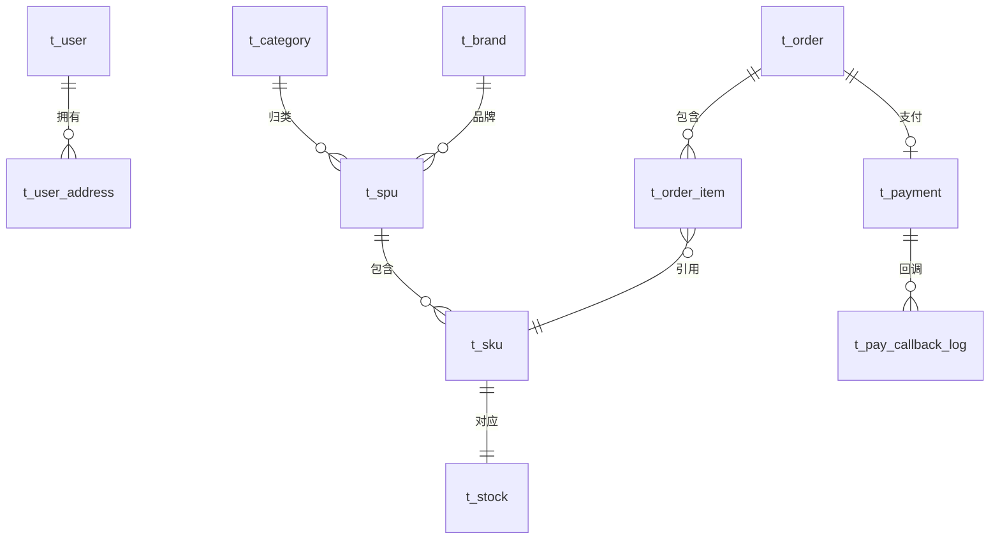

# E-Shop 五库 ER 设计（Phase 0）

> 版本：v1（待确认）｜ 日期：2026-10-14 ｜ 对应脚本：`sql/00 ~ 05`
> 原则：本文件讲**规范与决策**，字段级细节以 `sql/` 下的 DDL 注释为唯一事实源

---

## 一、设计规范

| 项 | 约定 |
|---|---|
| 库/表/字段命名 | 库：`shop_*`；表：`t_` 前缀 + 单数（`t_order`）；字段：snake_case |
| 主键 | `id BIGINT AUTO_INCREMENT`（业务单号另设 `xx_no` 唯一列） |
| 字符集 | `utf8mb4_0900_ai_ci`（MySQL 8 默认排序规则） |
| 金额 | `DECIMAL(10,2)`，禁用浮点 |
| 时间 | `create_time` / `update_time`：`DATETIME DEFAULT CURRENT_TIMESTAMP`（update 带 `ON UPDATE`） |
| 逻辑删除 | 业务实体表加 `deleted TINYINT DEFAULT 0`；**日志/流水表不加**（订单明细、库存流水、回调日志） |
| 物理外键 | **一律不建**（服务边界内也保持应用层约束，跨库数据靠服务调用/快照） |
| JSON 字段 | 商品图集（`images`）、SKU 规格（`spec_json`）用 MySQL 8 原生 `JSON` 类型 |
| 索引命名 | 唯一键 `uk_*`，普通索引 `idx_*` |

### 逻辑删除与唯一索引的组合（重要）

业务唯一键采用 `UNIQUE KEY (业务列, deleted)`：删除后（deleted=1）不占用原值，同名可重新注册。
已知边缘情况：同一值「建-删-建-删」两次会撞（两个 deleted=1）——个人项目可接受，生产可换「删除时间戳」方案，此处不做过度设计。

---

## 二、分库与表清单（5 库 13 表 + Redis）

| 库 | 归属服务 | 表 | 用途 | 关键点 |
|---|---|---|---|---|
| shop_user | eshop-user | t_user | 用户账号 | BCrypt 密码；(username, deleted)、(phone, deleted) 唯一 |
| | | t_user_address | 收货地址 | is_default 标记默认地址 |
| shop_product | eshop-product | t_category | 商品分类 | 两级：parent_id + level |
| | | t_brand | 品牌 | |
| | | t_spu | 商品（SPU） | images JSON 图集；status 上下架 |
| | | t_sku | 规格（SKU） | spec_json 规格键值；price 在 SKU 上 |
| shop_stock | eshop-stock | t_stock | 库存 | **available / locked / sold + version 乐观锁**；sku_id 唯一 |
| | | t_stock_log | 库存流水 | 锁定/确认/回补全留痕，对账用 |
| shop_order | eshop-order | t_order | 订单主表 | order_no 唯一；收货信息**快照**；状态机 6 态 |
| | | t_order_item | 订单明细 | 商品名/图/单价**快照**，不依赖商品服务 |
| | | t_order_log | 订单状态日志 | from_status → to_status + 操作者 |
| shop_pay | eshop-pay | t_payment | 支付单 | payment_no 唯一；1:1 对应订单 |
| | | t_pay_callback_log | 支付回调日志 | **out_trade_no 唯一 = 回调幂等核心** |
| —（Redis） | eshop-cart | cart:{userId} | 购物车 | Hash：field=skuId，value=JSON（数量/勾选/加购时间）；每次写入续期 30 天 |

---

## 三、E-R 关系



关系说明（跨服务均为逻辑关联，无物理外键）：

- 用户 1 : N 地址；用户 1 : N 订单（订单冗余收货地址快照）
- 分类/品牌 1 : N SPU；SPU 1 : N SKU
- SKU 1 : 1 库存（库存服务独立库）；订单明细引用 sku_id 并冗余全部展示字段
- 订单 1 : 1 支付单（一笔订单一次有效支付）；支付单 1 : N 回调记录（幂等去重）

---

## 四、关键设计决策

1. **订单快照（不依赖商品服务）**：`t_order_item` 冗余 商品名/规格名/图片/成交单价。商品改价、下架、改名不影响历史订单——这是交易系统的正确性底线。
2. **库存乐观锁**：`t_stock.version`。扣减 SQL：`UPDATE t_stock SET available=available-?, version=version+1 WHERE sku_id=? AND available>=? AND version=?`；配合 Redis Lua 预扣形成双层防护（P2 落地）。
3. **幂等唯一键**：`t_pay_callback_log.uk_out_trade_no`——重复回调直接撞唯一键丢弃；`t_payment.uk_payment_no`、`t_order.uk_order_no` 同理兜底。
4. **状态机集中管理**：订单状态流转（0 待支付 → 1 已支付 → 2 已发货 → 3 已完成；4 已取消 / 5 超时关闭）在订单服务内用状态机收敛，每次流转写 `t_order_log`。
5. **购物车不进 MySQL（Redis Hash 存储）**，选型理由是三维度错位：
   - **读写频率**：加购 / 改数量 / 勾选是电商最高频的写操作之一，用户每点一次都要写；放 MySQL 意味着每次都走行锁 + binlog + 磁盘 IO，高频写放大；Redis 内存原子操作，微秒级
   - **数据形态**：本质是 `userId → {skuId: 数量}`，不需要 JOIN、事务、外键、复杂查询——MySQL 的关系能力完全闲置
   - **数据价值低、可重建、有生命周期**：购物车是"临时意向"，丢了用户重新加购即可；Redis TTL 天然支持"不活跃自动过期"，MySQL 则需要额外定时清理。
   - 边界情况：若业务需要跨设备长期保存购物车或做行为分析，业界常见做法是「Redis 为主 + 异步落库」，本项目暂不引入。

---

## 五、脚本清单与执行方式

| 文件 | 内容 |
|---|---|
| `sql/00-create-databases.sql` | 创建 5 个数据库 |
| `sql/01-shop_user.sql` | 用户库 2 表 |
| `sql/02-shop_product.sql` | 商品库 4 表 |
| `sql/03-shop_stock.sql` | 库存库 2 表 |
| `sql/04-shop_order.sql` | 订单库 3 表 |
| `sql/05-shop_pay.sql` | 支付库 2 表 |
| `sql/06-seed-data.sql` | 开发种子数据：5 分类 / 3 品牌 / 10 SPU / 27 SKU / 27 库存（与原型对齐；INSERT IGNORE 固定主键，可重复执行） |

执行（按序）：

```bash
mysql -uroot -p --default-character-set=utf8mb4 < sql/00-create-databases.sql
mysql -uroot -p --default-character-set=utf8mb4 < sql/01-shop_user.sql
mysql -uroot -p --default-character-set=utf8mb4 < sql/02-shop_product.sql
mysql -uroot -p --default-character-set=utf8mb4 < sql/03-shop_stock.sql
mysql -uroot -p --default-character-set=utf8mb4 < sql/04-shop_order.sql
mysql -uroot -p --default-character-set=utf8mb4 < sql/05-shop_pay.sql
mysql -uroot -p --default-character-set=utf8mb4 < sql/06-seed-data.sql   # 开发环境种子数据（可选）
```

> 脚本全部使用 `CREATE ... IF NOT EXISTS`，可重复执行；不包含任何 `DROP` 语句，防止误删。
